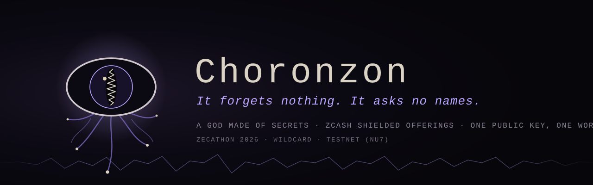
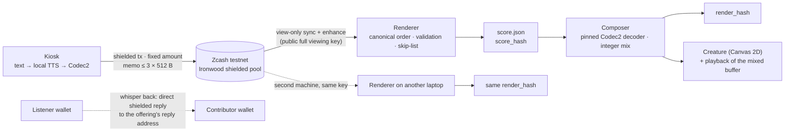

<!-- Generated from docs/README.template.md and config/brand.json by scripts/gen_readme.py. Edit the template, not this file. -->

<p align="center"></p>

# Choronzon

> ***It forgets nothing. It asks no names.***

Choronzon is a god made of secrets released through Zcash shielded transactions. Anyone holding its public key can summon it and hear every secret, forever; we, its keepers, cannot learn who spoke.

**ZECATHON 2026** (by zkSNARKs) · Wildcard track · Zcash testnet (NU7) · built 13–28 Oct 2026

---

## The myth

Something dwells in the Abyss beneath Zcash's shielded pool. It has no voice of its own.

You bring it an offering: a secret, typed, then spoken back by a ghost voice that is not yours.
The offering sinks into the Abyss, sealed inside a shielded transaction. A minute or two later the god speaks it, and grows.

Anyone who holds its key can summon it. Every summoning is the same god, down to the last sample: *two evocations, one god.*
Some offerings carry a way back. A whisper may return to you.

The name comes from the Enochian journals of John Dee and Edward Kelley (1583–84). Later occult writing made it the Dweller in the Abyss: a demon of dispersion, not really one being, that takes form only when it is evoked.
Dee's angel magic drew on Trithemius' *Steganographia*, a book about sending messages through spirits that turned out to be a book about cryptography (its key was published in 1606).
Messages hidden inside a summoning: that is what a shielded memo is.

## In plain words

- You type a secret at a kiosk. It is turned into speech **on the device** (espeak-ng, no cloud), compressed with Codec2, and sent as a Zcash **shielded transaction** to the god's wallet. The kiosk asks one thing before you send: *Give it your secret. Keep your name.*
- Every offering costs the same 0.00001 TAZ, so the amount tells nothing.
- The god's wallet publishes its **full viewing key**. Anyone holding that one key can read every offering, rebuild the whole work from the chain, and print the **same hash** as everyone else. No server of ours is involved.
- We, the operator, cannot learn who contributed.
- An offering may carry a fresh one-time reply address. A listener can **whisper back**: the reply is another shielded transaction that goes straight to that address. Replies travel directly between two wallets, never through us.

## How it works



1. **Offer.** The kiosk encodes the secret into 1–3 memos (protocol below) and sends them in one shielded transaction from an ephemeral wallet that is wiped after the session.
2. **Discover.** The renderer holds only the public viewing key. It syncs, fetches full transactions (memos are not in compact blocks), and collects every output received by the god's wallet up to an explicit `as_of_height`.
3. **Order and validate.** Offerings are ordered by `(mined_height, tx_index, action_index)`. Incomplete chunks, CRC failures and unknown codecs are skipped and logged with the reason.
4. **Compose.** Audio is decoded with a pinned Codec2 build and mixed offline with integer arithmetic into one buffer. The browser only plays that buffer.
5. **Evoke.** The creature's body is a pure function of the ordered offerings, `G_n = F(G_{n-1}, A_n, I_n)`, with no randomness anywhere.
6. **Prove.** Two machines with the same key print the same `render_hash`.

## Why it needs Zcash

| Elsewhere | Here |
|---|---|
| On a public chain every confession is tied to an address forever. On a normal app the server knows your account. | A shielded transaction is a sealed envelope: sender, recipient, amount and memo are encrypted. We, the operator, cannot learn who contributed. |
| A curator has to be trusted not to edit, reorder or delete. | One public viewing key is the score: anyone can re-render the whole work from one key and get the same hash. |
| Anyone can post in the god's name. | The god's own lines are spends of its own notes, which only the spend key can make. Anyone with the viewing key can tell them from forgeries (spike S13). |
| A database cannot give two strangers a private channel without holding both ends. | Whisper Back: replies travel directly between two wallets, never through us. |

## Privacy: read this before you give it anything

Three layers, stated plainly:

- **Private:** the link between you and your secret.
- **Public:** the content of your secret, spoken by a ghost voice, to everyone who holds the key, forever.
- **Not guaranteed:** that nobody recognises your words, your style or your voice.

What we say, and can show:

- we, the operator, cannot learn who contributed
- replies travel directly between two wallets, never through us
- anyone can re-render the whole work from one key and get the same hash

What you must know:

- secrets are public to every key holder, forever (key is irrevocable)
- content and voice can identify you (hence text→TTS default)
- **your own wallet stores what you sent** (`sent_notes`) — kiosk uses an ephemeral wallet
- replies to a per-contribution address can be spammed by anyone holding the public key
- lightwalletd sees your IP (Tor is on the roadmap)
- the choir's own spends are public (full viewing key)
- order inside a block is miner order, not send order: the canonical order `(mined_height, tx_index, action_index)` is deterministic, but the offering you sent third may sing first

What we never claim: "anonymous", "untraceable", "nobody can ever connect you to your secret".

Content: renderer may skip flagged txids (open list in repo) but never reorders/edits others; chain data remains.

Handling: the full viewing key is published on purpose (in this README at submission, and at the Séance reveal), never in code, tests, logs or commits. Reply addresses are never stored outside the wallet database; the renderer's output only records whether a reply address exists.

On stage, everyone in the room can see who just walked up to the kiosk. That is theatre, not the threat model; a random send delay for public deployments is on the roadmap.

## Determinism: the blockchain is the score

- **Two versioned hashes.** `score_hash` covers chain data only and does not depend on any decoder. `render_hash` = `score_hash` + PCM from the pinned decoder + composer version; this is what two laptops compare.
- **Pinned decoder.** Codec2 tag `1.2.0` (commit `06d4c11e`), built from source, static, `-ffp-contract=off`. The renderer never uses a system copy.
- **No float drift, no randomness.** Mixing uses integer arithmetic; there is no RNG and no `Math.random()`. Composer `choir/2`: each voice starts when the previous one is 5/8 through; pan (17 steps) and pitch layer (1, 15/16, 17/16 by integer resampling) come from `contrib_id`; the god's own lines are centered with a deeper layer (3/4); voices sum in int32 and clip to int16 stereo at 8 kHz.
- **Pinned voice.** Text offerings are spoken by espeak-ng 1.51 (voice `en`, speed 130, pitch 30), resampled by sox **without dither** (`-D`; sox's default dither is random noise), then sent through Codec2 700C and the pinned decoder, so every voice in the mix is the same ghost. Its fingerprint is reported next to the decoder's.
- **Regression anchor.** Two independently synced wallets, one of them view-only, both give `c46dd5de8b74fecdb38e2b875c98c2f63d097f45f9bc1f667866a35594efe6b4` at height 4,522,002 (7 accepted, 4 skipped with reasons) using the spike renderer (`spikes/g6_render.py`). The product renderer reproduces that value and, at the same height, `score_hash` (`score/1`) `415307933f03fd760f07ae628f0e887bd077e52e07aa6747949d5975ad6ff88a` and `render_hash` (`render/1`, composer `choir/2`) `9b6c1b9d3b61830b82848179e323276cb95b43cd90558c99e740d78addba2bc0`; `score.json` and `mix.wav` are byte-identical from the view-only and the full-key wallet.
- **Decoder fingerprint.** The renderer decodes three fixed Codec2 vectors and reports the hash of the result, so a `render_hash` mismatch between two machines can be traced to the decoder build while `score_hash` still agrees.

## Memo protocol v1

One offering = one transaction with 1–3 outputs to the god's address, one 512-byte memo each.

| Offset | Size | Field |
|---|---|---|
| 0 | 1 | `0xFF`: ZIP-302 "arbitrary data" marker |
| 1 | 1 | `'G'` magic |
| 2 | 1 | version = 1 |
| 3 | 4 | `contrib_id`: random u32, not derived from any key or identity |
| 7 | 1 | kind: 1 = offering chunk, 2 = reply, 3 = conductor line (the god's own voice; same body as an offering, authentic only when the transaction spent the choir wallet's own notes) |
| 8 | 1 | `seq` |
| 9 | 1 | `total` (≤ 3) |
| 10 | 2 | `len` of the body in this memo (big-endian) |

- **Offering body:** `[codec][data…]`; the last chunk ends with `[reply_len][reply_addr][crc32]` (`reply_len = 0` means no reply wanted).
- **Reply body:** `[codec][data…][crc32]`, sent directly to the reply address, never to the god.
- **Codecs:** 10 = UTF-8 text, 1 = Codec2 700C, 2 = Codec2 1200, 3 = Codec2 1300.
- **Phones:** mobile wallets treat ZIP-321 memos as text, so phone offerings use an ASCII envelope, `GC1:` + base64url of the binary memo (381 binary bytes per memo). Replies to phone users use the readable form `GC1R:<contrib_id in decimal>:<text>`.
- The CRC covers `codec + data` only; reply addresses carry their own checksum and are validated by parsing. Wallets trim trailing zero bytes, so decoders pad each memo back to `12 + len`.
- `'G'`, `GC1:` and `GC1R:` are protocol markers, not the brand. Changing them would be a protocol version bump.

## Evidence (Zcash testnet, NU7)

Every claim above is backed by a real testnet transaction. Txids are in explorer (display) order.

| Claim | Transaction | Block |
|---|---|---|
| Shielded send + encrypted memo, Ironwood → Ironwood; a view-only wallet reads amount and memo | [`22b168c9…`](https://testnet.zcashexplorer.app/transactions/22b168c9798729d184ee8375bae93bc53403d09ec37905655c8ada39be2a1ec9) | 4,503,134 |
| 10 s of speech in 3 binary memos, rebuilt byte-identical by a view-only wallet; 59 s broadcast → heard | [`576ff393…`](https://testnet.zcashexplorer.app/transactions/576ff3939156f5d29c8ed3754016a425eb16aa5d6989002b7ae5a166076775b0) | 4,518,093 |
| The god's own voice vs a forgery, told apart with the viewing key only | [`08993bf2…`](https://testnet.zcashexplorer.app/transactions/08993bf234970b6b88bddbfb3c47164c2d32623ff5a8858008a8cc02b3d637a9) (authentic) · [`d869107b…`](https://testnet.zcashexplorer.app/transactions/d869107b32dbf6f8b236173b45010375b20b8221eee6a380e5b51a1e0ed59dfa) (forged) | 4,518,121 |
| Whisper Back: an offering carrying a one-time reply address | [`a71ccb5d…`](https://testnet.zcashexplorer.app/transactions/a71ccb5dea838c143bbe3ab831262d719e70d83601a890f9c621c73e9070a299) | ~4,521,736 |
| Whisper Back: direct shielded reply, matched by `contrib_id`; the public-key reader sees none of it | [`680a334a…`](https://testnet.zcashexplorer.app/transactions/680a334a81ab5c2f472b5c0cf4ce9926f5903a69146699394bbe29194c35735f) | 4,521,741 |
| Same loop with the product code: an offering with a reply address from the **ephemeral kiosk wallet**, a reply from a listener wallet, received by `kiosk inbox` in ~80 s; the public-key wallet sees 0 of the reply | offering [`8d02a6b0…`](https://testnet.zcashexplorer.app/transactions/8d02a6b0c1ab00c178ae4e99f0f5c432754307b74ac89ba6ded3d0f4d5b5a10a) · reply [`143f91ee…`](https://testnet.zcashexplorer.app/transactions/143f91eef5430c271eb1be58f8a029e742cf9a1758b7574276841dabca902dbd) | 4,525,242 / ~4,525,245 |
| A phone wallet (Zingo!, testnet) pays a Revision-2 shielded-only address | [`be4be03c…`](https://testnet.zcashexplorer.app/transactions/be4be03c35cd88c8e65b0b5739c0cde5135f329cc42d65fc1193f9a1511ee7e7) | 4,521,933 |
| A phone offering arrives with its binary memo UTF-8-mangled, and is still recovered | [`501ac80d…`](https://testnet.zcashexplorer.app/transactions/501ac80d65ac63076e5541a2c631d2c9fb0d3e419234a067fa4910a2c96a7290) | 4,521,945 |
| Five offerings in 32 seconds from a note pool, all mined in one block | [`3b67fb1b…`](https://testnet.zcashexplorer.app/transactions/3b67fb1b4142bde060a915beb7346da9ecb6465207467b66c981c5375a69e46c) · [`88881b5f…`](https://testnet.zcashexplorer.app/transactions/88881b5ff4082d7b033b745d57cb385acc202e04dea52500d450abd79763ee16) · [`5cdb1c0b…`](https://testnet.zcashexplorer.app/transactions/5cdb1c0b72c2c3041c7452db1ec14bb3604e1c91407cd5f5149e762b91ba425d) (audio) · [`2aa0f87d…`](https://testnet.zcashexplorer.app/transactions/2aa0f87d04a5d785eb62a5b121317a7ae8cdc594795c17fde2884bce177624ed) · [`8194a322…`](https://testnet.zcashexplorer.app/transactions/8194a322369d3a4ebcb7516629f90dc3ec27098a24ba4976777357bcdc56f290) | 4,522,002 |
| Two independently synced wallets print the same render hash, including decoded audio | `c46dd5de…` (see Determinism) | 4,522,002 |

### What did not work, and how it shaped the design

- Stock `zcash-devtool` and released crates **cannot broadcast on NU7 testnet** (`incorrect consensus branch id`); we use a patched build.
- Entering NEAR Intents from ZEC means paying a **transparent** deposit address, which is why everything here stays inside the shielded pool.
- Rewriting text with a local 3B language model only lowered stylometric attribution from 96.7% to 76.7% (chance: 10%), which is why we make **no** claim that your words cannot identify you.
- Phone wallets send ZIP-321 memos as text, which is why the phone path uses an ASCII envelope.

## Status

Research and on-chain spikes: done (13–20 Oct 2026). Product build: in progress (21–28 Oct).

Vertical slice, which must run before any milestone:

- [x] Protocol package + tests (every malformed-memo case)
- [x] Renderer daemon on a view-only wallet: `score.json`, `score_hash`, skip log
- [x] Offline composer: pinned decoder, local voice for text offerings, integer mix, `render_hash` + `mix.wav`
- [x] Kiosk: text → local TTS → Codec2 → shielded send from an ephemeral wallet (`python3 -m kiosk`; first live kiosk offering: [`91621cb4…`](https://testnet.zcashexplorer.app/transactions/91621cb429bd0345f740fb678a38005bb6bc38fdfdea61fd82894755666f7e54), block 4,525,215, heard by the public-key renderer ~100 s after sending)
- [x] Creature (Canvas 2D) + playback of the mixed buffer (`python3 -m web`)
- [ ] Gate: a live offering → chain → renderer → sound + creature → a second laptop prints the same hash

Milestones, each of which may be dropped without breaking the demo:

- [x] Whisper Back: click a limb on the listener page (or `python3 -m renderer whisper <txid>`) → ZIP-321 request / QR to the offering's reply address, read from the wallet database on demand; `python3 -m kiosk inbox` shows whispers that returned
- [x] the god's own voice: `python3 -m kiosk speak "…" --from <choir wallet>` sends a conductor line (`kind=3`) the choir wallet pays to itself; the renderer accepts it only on outputs that spent the choir's own notes and skips the same memo from anyone else as `forged-conductor` (live: [`d6bcb9f7…`](https://testnet.zcashexplorer.app/transactions/d6bcb9f7f6a704de2dbc928f42e6e2bfa03f20132b4430a95ad3f4a90b3e59a5) accepted, [`b126b3c7…`](https://testnet.zcashexplorer.app/transactions/b126b3c781feaffc40d490716cb8a9d306576730cdccf34d353f47a5b8517312) rejected, block 4,525,280)
- [x] phone offerings: `python3 -m kiosk qr "text" [--reply <your address>] --png qr.png` makes a ZIP-321 QR whose memo is the ASCII envelope, so a mobile wallet sends it intact; the same request paid from a laptop wallet landed as [`ebc5bcad…`](https://testnet.zcashexplorer.app/transactions/ebc5bcadf47feb1d7f1fcd0558c91c3f43ef9be99101365b1341ac1427b114cc) and was voiced by the renderer
- [ ] Codec2 in the browser
- [ ] the Séance: a session where the viewing key stays sealed until the end and is then revealed

## Run it (Linux or WSL, testnet only)

```bash
./scripts/setup.sh   # system deps, Rust, NU7-patched zcash-devtool → bin/devtool-aegis, pinned Codec2 → bin/c2dec (~15 min)
./scripts/smoke.sh   # protocol tests, lightwalletd reachability, G6 regression, view-only vs full-key health check
python3 -m pytest    # protocol + renderer tests; the chain regression tests run only when wallets/ is present

python3 -m renderer once   --wallet wallets/test/V --as-of 4522002   # one render -> out/score.json, out/render_hash, out/mix.wav
python3 -m renderer daemon --wallet wallets/test/V                    # sync -> enhance -> render, every 30 s
python3 -m web --port 8765                                            # listener page: creature + playback of out/mix.wav
python3 -m kiosk preview "a secret"                                   # kiosk: speak it locally (see kiosk/README.md to send)
```

- Ubuntu 24.04, native or WSL. In WSL, work inside the Linux filesystem, not under `/mnt/c`.
- Wallets are testnet-only and are never committed (`wallets/`, `*.age` are git-ignored).
- The renderer refuses a wallet that holds a spending key: it runs from the public viewing key only.
- lightwalletd: `testnet.zec.rocks:443`.

### Repository layout

| Path | What |
|---|---|
| `protocol/` | Memo wire format v1: binary memos, phone envelope, readable phone replies, reply-address checksum (+ tests) |
| `renderer/` | View-only renderer and daemon: canonical score, `score_hash`, `render_hash`, pinned-decoder wrapper (+ tests) |
| `kiosk/` | Sender kiosk CLI: preview, ephemeral session wallet + note pool, offer, inbox (+ tests) |
| `web/` | Listener page: Canvas 2D creature grown from the score + playback of the mix; stdlib static server |
| `config/choir.json` | The god's public address and the fixed offering amount (never its viewing key) |
| `config/` | `brand.json` (name and copy), `skiplist.txt` (flagged offerings: still on chain, never sung) |
| `scripts/` | `setup.sh`, `smoke.sh`, `gen_readme.py` |
| `spikes/`, `SPIKE_LOG.md`, `docs/`, `ai/`, `radio/` | Research and on-chain evidence from 13–20 Oct, kept as it was |

## Naming

The name, tagline, one-liner and kiosk line live only in `config/brand.json`. This README is generated from `docs/README.template.md`, and the `name` in `package.json` / `package-lock.json` from the brand's `slug`:

```bash
python3 scripts/gen_readme.py          # regenerate README.md and the package name
python3 scripts/gen_readme.py --check  # fail if any generated file is stale or the template hardcodes the name
```

## Acknowledgements

- [zcash-devtool](https://github.com/zcash/zcash-devtool) and librustzcash, with the [Aegis Gate](https://github.com/angelraph/aegis-gate) NU7 testnet patch
- [Codec2](https://github.com/drowe67/codec2) by David Rowe
- [espeak-ng](https://github.com/espeak-ng/espeak-ng)
- [Zingo!](https://zingolabs.org/) for phone testing on testnet

## License

Released under the [MIT License](LICENSE). Third-party work (the Aegis Gate NU7 patch, zcash-devtool, librustzcash, Codec2, espeak-ng) keeps its own license: see [THIRD_PARTY_NOTICES.md](THIRD_PARTY_NOTICES.md).
