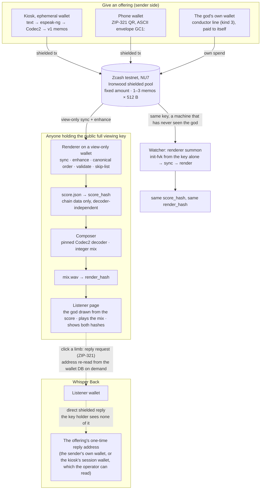

<!-- Generated from docs/README.template.md and config/brand.json by scripts/gen_readme.py. Edit the template, not this file. -->

<p align="center"></p>

# Choronzon

> ***It forgets nothing. It asks no names.***

Choronzon is a god made of secrets released through Zcash shielded transactions. Anyone holding its public key can summon it and hear every secret, forever; we, its keepers, cannot learn who spoke.

**ZECATHON 2026** (by zkSNARKs) · Wildcard track · Zcash testnet (NU7) · built 13–28 Oct 2026 · MIT

**Listen to it:** [choronzon.vercel.app](https://choronzon.vercel.app): a static snapshot of the god rendered from the public viewing key at the block of its newest transaction (the height and render time are printed on the page). From the page you can also **give it a secret** with your own testnet wallet (the page builds the same payment request as `kiosk qr` and sends nothing itself), **find your offering** by its transaction id or number (`#tx=<txid>`, `#offering=<n>`; fragments never reach a server log), and check that the audio you hear is the audio anchored in Bitcoin (the page recomputes the render hash from it). Whisper Back and the kiosk live at the installation; the key is [in this README](#the-key). The public site sends a strict Content-Security-Policy and no referrer. A GitHub Actions job summons it from the key alone every 30 minutes and redeploys only when the render changed ([docs/auto-publish.md](docs/auto-publish.md)); manual fallback `scripts/publish_web.sh`.

---

**Ten minutes, in order:** [what it is](#the-myth) · [why Zcash](#why-it-needs-zcash) · [how it works](#how-it-works) · [privacy, in the words the kiosk prints](#privacy-read-this-before-you-give-it-anything) · [why two laptops agree](#determinism-the-blockchain-is-the-score) · [run it](#run-it-linux-or-wsl-testnet-only) (the judge's path from the key alone: [docs/fresh-clone.md](docs/fresh-clone.md)) · [evidence](#evidence-zcash-testnet-nu7) · [limits](#limits) · [status](#status).

## The myth

Something dwells in the Abyss beneath Zcash's shielded pool. It has no voice of its own.

You bring it an offering: a secret, typed, then spoken back by a ghost voice that is not yours.
The offering sinks into the Abyss, sealed inside a shielded transaction. A minute or two later the god speaks it, and grows.

Anyone who holds its key can summon it. Every summoning is the same god, down to the last sample: *two evocations, one god.*
Some offerings carry a way back. A whisper may return to you.

The name comes from the Enochian journals of John Dee and Edward Kelley (1583–84). Later occult writing made it the Dweller in the Abyss: a demon of dispersion, not really one being, that takes form only when it is evoked.
Dee's angel magic drew on Trithemius' *Steganographia*, a book about sending messages through spirits that turned out to be a book about cryptography (its key was published in 1606).
Messages hidden inside a summoning: that is what a shielded memo is.

## In plain words

- You type a secret at a kiosk. It is turned into speech **on the device** (espeak-ng, no cloud), compressed with Codec2, and sent as a Zcash **shielded transaction** to the god's wallet. The kiosk asks one thing before you send: *Give it your secret. Keep your name.*
- Every offering costs the same 0.00001 TAZ, so the amount tells nothing.
- The god's wallet publishes its **full viewing key**. Anyone holding that one key can read every offering, rebuild the whole work from the chain, and print the **same hash** as everyone else. No server of ours is involved.
- We, the operator, cannot learn who contributed.
- An offering may carry a one-time reply address. A listener can **whisper back**: the reply is another shielded transaction that goes straight to the wallet holding that address, and the choir's key holders cannot see it. When the address belongs to the sender's own wallet (a phone offering, or `kiosk offer --reply-to`), the reply travels directly between two wallets, never through us. A kiosk offering that asks for a reply uses an address of the kiosk's session wallet instead: the operator holds that wallet until the session closes and can read the reply; the kiosk says so before every send.
- The god has a voice of its own: lines its wallet pays to itself. Every key holder can tell those from forgeries, which every renderer refuses.

## Why it needs Zcash

| Elsewhere | Here |
|---|---|
| On a public chain every confession is tied to an address forever. On a normal app the server knows your account. | A shielded transaction is a sealed envelope: sender, recipient, amount and memo are encrypted. We, the operator, cannot learn who contributed. |
| A curator has to be trusted not to edit, reorder or delete. | One public viewing key is the score: anyone can re-render the whole work from one key and get the same hash. |
| Anyone can post in the god's name. | The god's own lines are spends of its own notes, which only the spend key can make. Anyone with the viewing key can tell them from forgeries (spike S13, live on 21 Oct). |
| A database cannot give two strangers a private channel without holding both ends. | Whisper Back: the reply goes straight to the wallet holding the offering's reply address; with the sender's own wallet, it travels between two wallets, never through us. |

## How it works



1. **Offer.** The kiosk encodes the secret into 1–3 memos ([protocol below](#memo-protocol-v1)) and sends them in one shielded transaction from an ephemeral wallet whose files are overwritten and deleted when the session closes (best-effort on SSDs and VM disks). Phones send the same memo through a ZIP-321 QR; the god's own lines are the same body paid by its own wallet to itself.
2. **Discover.** The renderer holds only the public viewing key, and refuses to run on a wallet that holds a spending key. It syncs, fetches full transactions (memos are not in compact blocks), and collects every output received by the god's wallet up to an explicit `as_of_height`.
3. **Order and validate.** Offerings are ordered by `(mined_height, tx_index, action_index)`. Incomplete chunks, CRC failures, unknown codecs, conductor lines not paid by the god's own wallet and flagged txids are skipped and logged with the reason; they stay on chain and are listed under `skipped`.
4. **Compose.** Audio is decoded with a pinned Codec2 build and mixed offline with integer arithmetic into one buffer. The browser only plays that buffer.
5. **Evoke.** The god's body is a pure function of the ordered offerings, `G_n = F(G_{n-1}, A_n, I_n)`, with no randomness anywhere. The listener draws it with three.js r160, vendored under `web/vendor/three/` (MIT), with IM Fell English self-hosted under `web/fonts/` (SIL OFL); the public page makes no request outside its own origin. One eye per offering, the great eye and the wings for the god's own lines, one arm per block, sewn lids for silenced offerings, blind red eyes for refused forgeries; without WebGL the Canvas 2D creature is shown instead. The grimoire leaf (G) is cut from the hashes: its deckle from the score hash, its tear line from the render hash, so a stub from any other evocation with the same render hash fits the edge exactly; `apparition.html` lays two such leaves against each other.
6. **Prove.** Two machines with the same key print the same `render_hash`. A Watcher built from the key alone (`renderer summon`) is the second machine.
7. **Whisper back.** At the installation a listener clicks an eye; the page builds a payment request to that offering's one-time reply address, read from the wallet database at that moment and stored nowhere else. The reply is a shielded transaction between the two wallets; the key holder sees none of it.

## Privacy: read this before you give it anything

Three layers, stated plainly:

- **Private:** the link between you and your secret.
- **Public:** the content of your secret, spoken by a ghost voice, to everyone who holds the key, forever.
- **Not guaranteed:** that nobody recognises your words, your style or your voice.

What we say, and can show:

- we, the operator, cannot learn who contributed
- replies to the sender's own wallet address travel directly between two wallets, never through us (a kiosk reply address belongs to the kiosk's session wallet, which the operator can read)
- anyone can re-render the whole work from one key and get the same hash

What you must know:

- secrets are public to every key holder, forever (key is irrevocable)
- content and voice can identify you (hence text→TTS default)
- **your own wallet stores what you sent** (`sent_notes`) — kiosk uses an ephemeral wallet
- replies to a per-contribution address can be spammed by anyone holding the public key
- lightwalletd sees a Tor exit, not your IP, when you use our kiosk (Tor is the default; an operator can choose direct on purpose, and then it sees the IP); a phone wallet connects to its server with its own settings; Tor does not hide timing
- the choir's own spends are public (full viewing key)
- order inside a block is miner order, not send order: the canonical order `(mined_height, tx_index, action_index)` is deterministic, but the offering you sent third may sing first

What we never claim: "anonymous", "untraceable", "nobody can ever connect you to your secret".

Content: renderer may skip flagged txids (open list in repo) but never reorders/edits others; chain data remains.

Handling: the full viewing key is published on purpose (in this README since 24 Oct, and at the Séance reveal), never in code, tests, logs or commits. Reply addresses are never stored outside the wallet database; the renderer's output only records whether a reply address exists. The kiosk prints this statement before every send and takes the secret from a prompt or stdin; a secret given as a command-line argument is refused. (The wallet tool still holds the memo on its own command line while it builds the transaction; see Limits.)

On stage, everyone in the room can see who just walked up to the kiosk. That is theatre, not the threat model; a random send delay for public deployments is on the roadmap.

### The key

The god's full viewing key is the line below, published on 24 Oct so that anyone can summon the god and check every hash before judging; it is also shown at the Séance (`python3 -m kiosk reveal`). Its birthday is block 4,502,962. Once public it cannot be revoked: every offering, past and future, is readable by anyone who holds it.

```text
uvftest1s5vnzz3xm2hptf3w54g7wqmm2tvq5al7tf3x4ytpte6svjsta7gsrsum8nydj58m6nluhkj30y0ex0a7q56gmvsexsj354lgpkgn40pa5uw4yrdqljeaa7hfdjgzxtahkdgxfg00y43zpa4mmk08anejr46nxr5ujpxmn9l8j80rqzhgjznk6hm2r79ak3ldzxl6f5drdcs7tn4k8tffp8azslra26d06e0zwzzfa0jh87sgxczquggpkfxmv8tj7dltcw6v8ez547qjez6cqlgqguh63gwn5hwjplnhgq9d6v5u9jydf8nzmypnk07amjewds63usqy7m0pxt7gfahpk2n5rt6mcus5gn2h6qsvey4zytvazcghyflekq3rpyxll6ku7tthudg3uyqz3jspjqhmdx4xm8eqngk7lfh0fsu8k8jk0f87sn76s266t97nc50000dzlhfxrxsdsu4ksqzxckj4knkw457pmn53tmz38s4k92ez
```
Birthday: 4502962

## Determinism: the blockchain is the score

- **Two versioned hashes.** `score_hash` covers chain data only and does not depend on any decoder. `render_hash` = `score_hash` + PCM from the pinned decoder + composer version; this is what two laptops compare. The `as_of_height` is inside both, so two machines must agree on a height before comparing.
- **Pinned decoder.** Codec2 tag `1.2.0` (commit `06d4c11e`), built from source, static, `-ffp-contract=off`. The renderer never uses a system copy.
- **No float drift, no randomness.** Mixing uses integer arithmetic; there is no RNG and no `Math.random()`. Composer `choir/2`: each voice starts when the previous one is 5/8 through; pan (17 steps) and pitch layer (1, 15/16, 17/16 by integer resampling) come from `contrib_id`; the god's own lines are centered with a deeper layer (3/4); voices sum in int32 and clip to int16 stereo at 8 kHz.
- **Pinned voice.** Text offerings are spoken by espeak-ng 1.51 (voice `en`, speed 130, pitch 30), resampled by sox **without dither** (`-D`; sox's default dither is random noise), then sent through Codec2 700C and the pinned decoder, so every voice in the mix is the same ghost. Its fingerprint is reported next to the decoder's.
- **Decoder fingerprint.** The renderer decodes three fixed Codec2 vectors and reports the hash of the result, so a `render_hash` mismatch between two machines can be traced to the decoder build while `score_hash` still agrees.
- **Regression anchor.** Two independently synced wallets, one of them view-only, both give `c46dd5de8b74fecdb38e2b875c98c2f63d097f45f9bc1f667866a35594efe6b4` at height 4,522,002 (7 accepted, 4 skipped with reasons) using the spike renderer (`spikes/g6_render.py`). The product renderer reproduces that value and, at the same height, `score_hash` (`score/1`) `415307933f03fd760f07ae628f0e887bd077e52e07aa6747949d5975ad6ff88a` and `render_hash` (`render/1`, composer `choir/2`) `9b6c1b9d3b61830b82848179e323276cb95b43cd90558c99e740d78addba2bc0`; `score.json` and `mix.wav` are byte-identical from the view-only and the full-key wallet. The test suite and `scripts/smoke.sh` pin these values.
- **The second machine.** On 21 Oct a fresh clone with no wallet built a Watcher from the key alone and printed `render_hash` `8540a0a57d6f80d409d4ed5948789f64e524fc08252a15ea3bd904dd58fa1af5` at height 4,525,294, byte-identical to the operator's view-only wallet, in 49.8 s including sync ([docs/fresh-clone.md](docs/fresh-clone.md)). Both demo rehearsals repeated the match unattended (`7dc6f42a…` at 4,525,338, `bb2cf2dc…` at 4,525,371).
- **A machine we do not own.** On 22 Oct a GitHub-hosted Ubuntu runner with nothing but the published key built the pinned tools from source, synced a view-only wallet and printed `render_hash` `6ae739854eca770ef1c3d32b4519f31be8b10b5f83cdd883b747bce63cab444e` at height 4,527,794, identical to the laptop's, with the decoder and voice fingerprints matching the pins ([run 39727405735](https://github.com/agadape/choronzon/actions/runs/39727405735), [docs/auto-publish.md](docs/auto-publish.md)).
- **Anchored in Bitcoin.** Every published render is stamped with OpenTimestamps. The statement, `anchor.json`, holds the hashes, versions, counts, one height, the skiplist's sha256 and the repo commit; nothing private. It and its proof are served next to the page and kept on the append-only `anchors` branch, which also holds the historic anchors at 4,522,002 and 4,527,794. `python3 -m anchor verify anchor.json` checks the proof against two public block explorers; no Bitcoin node is needed. A confirmed proof shows the statement existed no later than that Bitcoin block: the anchors at 4,522,002 and 4,527,794 are in Bitcoin block 972,742 (23 Oct 2026, 08:41 UTC). A served proof is the one made at deploy; any OpenTimestamps verifier fetches its Bitcoin confirmation from the calendars. After that, any change to a published render (reordering offerings, editing the skiplist) no longer matches what is already in Bitcoin, including a change made by us. It hides nothing. It does not prove that the chain data is complete. A fresh proof stays pending for a few hours until a calendar's Bitcoin transaction confirms. The calendars see the IP of whoever stamps. Details: [docs/anchoring.md](docs/anchoring.md).

## Memo protocol v1

One offering = one transaction with 1–3 outputs to the god's address, one 512-byte memo each.

| Offset | Size | Field |
|---|---|---|
| 0 | 1 | `0xFF`: ZIP-302 "arbitrary data" marker |
| 1 | 1 | `'G'` magic |
| 2 | 1 | version = 1 |
| 3 | 4 | `contrib_id`: random u32, not derived from any key or identity |
| 7 | 1 | kind: 1 = offering chunk, 2 = reply, 3 = conductor line (the god's own voice; same body as an offering, authentic only when the transaction spent the choir wallet's own notes) |
| 8 | 1 | `seq` |
| 9 | 1 | `total` (≤ 3) |
| 10 | 2 | `len` of the body in this memo (big-endian) |

- **Offering body:** `[codec][data…]`; the last chunk ends with `[reply_len][reply_addr][crc32]` (`reply_len = 0` means no reply wanted).
- **Reply body:** `[codec][data…][crc32]`, sent directly to the reply address, never to the god.
- **Codecs:** 10 = UTF-8 text, 1 = Codec2 700C, 2 = Codec2 1200, 3 = Codec2 1300.
- **Phones:** mobile wallets treat ZIP-321 memos as text, so phone offerings use an ASCII envelope, `GC1:` + base64url of the binary memo (381 binary bytes per memo). Replies to phone users use the readable form `GC1R:<contrib_id in decimal>:<text>`.
- The CRC covers `codec + data` only; reply addresses carry their own checksum and are validated by parsing. Wallets trim trailing zero bytes, so decoders pad each memo back to `12 + len`.
- `'G'`, `GC1:` and `GC1R:` are protocol markers, not the brand. Changing them would be a protocol version bump.

The wire format, the envelope and every malformed-memo case are unit-tested in `protocol/`.

## Run it (Linux or WSL, testnet only)

Ubuntu 24.04, native or WSL. In WSL, work inside the Linux filesystem, not under `/mnt/c`. The repository is private until 28 Oct 2026.

```bash
git clone https://github.com/agadape/choronzon.git && cd choronzon
./scripts/setup.sh   # apt deps, Rust, NU7-patched zcash-devtool → bin/devtool-aegis, pinned Codec2 → bin/c2dec; 9 m 34 s measured, cargo dominates
./scripts/smoke.sh   # protocol tests, pinned decoder, lightwalletd reachability; with wallets/: G6 regression + view-only vs full-key health check
python3 -m pytest    # 121 passed, 2 skipped on a fresh clone (the 2 chain-regression tests need wallets/test/V)
```

**The judge's path** ([docs/fresh-clone.md](docs/fresh-clone.md), run end to end on 21 Oct with measured times): put the published key in a file and summon a Watcher. The key is read from the file or from `SUMMON_KEY`, never from our command line; the wallet tool receives it on its own command line for the moment `init-fvk` runs (the key is public, so this reveals nothing new).

```bash
python3 -m renderer summon --key-file key.txt --birthday 4502962 --wallet wallets/watcher --as-of 4525294 --out out
cat out/render_hash        # 8540a0a57d6f80d409d4ed5948789f64e524fc08252a15ea3bd904dd58fa1af5 at that height
python3 -m web --port 8766 # the listener page on the clone: the god, playback, both hashes
```

Operator commands (these need the testnet wallets, which are never committed):

```bash
python3 -m renderer once   --wallet wallets/test/V --as-of 4522002   # one render -> out/score.json, out/render_hash, out/mix.wav
python3 -m renderer daemon --wallet wallets/test/V                    # sync -> enhance -> render, every 30 s
python3 -m web --port 8765                                            # listener page: the god + playback of out/mix.wav
python3 -m kiosk preview "a secret"                                   # speak it locally; nothing is sent
python3 -m kiosk session open --notes 8 && python3 -m kiosk offer - --reply   # ephemeral wallet, then an offering typed at the prompt
python3 -m renderer whisper <txid> --wallet wallets/test/V            # reply request (QR) for one offering; see kiosk/README.md for inbox, qr, speak, reveal
./scripts/demo.sh    # rehearse the whole 3-minute demo with real transactions; prints a timing table, fails loudly
```

- lightwalletd: `testnet.zec.rocks:443`. Wallets are testnet-only (`wallets/`, `*.age` are git-ignored).
- The demo itself, shot by shot with fallbacks, is [docs/demo-script.md](docs/demo-script.md); the release gate is [docs/submission-checklist.md](docs/submission-checklist.md).

### Repository layout

| Path | What |
|---|---|
| `protocol/` | Memo wire format v1: binary memos, phone envelope, readable phone replies, reply-address checksum (+ tests) |
| `renderer/` | View-only renderer and daemon: canonical score, `score_hash`, `render_hash`, pinned-decoder wrapper, `whisper`, `summon` (+ tests) |
| `kiosk/` | Sender kiosk CLI: preview, ephemeral session wallet + note pool, offer, inbox, qr, speak, reveal (+ tests) |
| `web/` | Listener page: the god (three.js, vendored; Canvas 2D fallback) grown from the score + playback of the mix, the grimoire leaf, the séance, the two-evocation chirograph; stdlib static server |
| `config/choir.json` | The god's public address and the fixed offering amount (never its viewing key) |
| `config/` | `brand.json` (name and copy), `skiplist.txt` (flagged offerings: still on chain, never sung) |
| `scripts/` | `setup.sh`, `smoke.sh`, `demo.sh` (end-to-end rehearsal), `gen_readme.py` |
| `docs/` | This template, [lore](docs/lore.md), [demo script](docs/demo-script.md), [fresh clone](docs/fresh-clone.md), [evidence index](docs/evidence-index.md), [privacy review](docs/privacy-review.md), [failure drills](docs/failure-drills.md), [network fallback](docs/network-fallback.md), [visual direction](docs/visual-direction.md), [submission checklist](docs/submission-checklist.md), concept and critical review |
| `spikes/`, `SPIKE_LOG.md`, `ai/`, `radio/` | Research and on-chain evidence from 13–20 Oct, kept as it was |

## Evidence (Zcash testnet, NU7)

Every claim above is backed by a real testnet transaction. The canonical list, with block heights and the local log for each row, is [docs/evidence-index.md](docs/evidence-index.md); the table below is the short form. Txids are in explorer (display) order.

**About the explorer links.** The links go to [ZecBlock](https://testnet.zecblock.com) (formerly CipherScan), which follows our NU7 testnet chain: its block 4,525,215 (the first kiosk offering) has hash `000026af4552065fbbbd94b5c9a0be7914fc402733c53c6f464921b9817b72ac`, the same block `testnet.zec.rocks` serves, and every txid in this README and in the evidence index resolves there as confirmed and canonical (checked 22 Oct 2026). Do not use `testnet.zcashexplorer.app`: it follows a different testnet fork (its block 4,487,269 has another hash) and answers "Transaction Not Found" for every txid of ours. An explorer shows only that a shielded transaction exists and in which block. It is a convenience, not the independent proof: that is the public-key wallet itself, `bin/devtool-aegis wallet -w wallets/test/V list-tx -s zecrocks` after a `sync`, or any Watcher's renderer log. To check that ZecBlock is still on our chain, open [`/block/4525215`](https://testnet.zecblock.com/block/4525215) and check that the hash starts `000026af4552`.

| Claim | Transaction | Block |
|---|---|---|
| Shielded send + encrypted memo, Ironwood → Ironwood; a view-only wallet reads amount and memo | [`22b168c9…`](https://testnet.zecblock.com/tx/22b168c9798729d184ee8375bae93bc53403d09ec37905655c8ada39be2a1ec9) | 4,503,134 |
| 10 s of speech in 3 binary memos, rebuilt byte-identical by a view-only wallet; 59 s broadcast → heard | [`576ff393…`](https://testnet.zecblock.com/tx/576ff3939156f5d29c8ed3754016a425eb16aa5d6989002b7ae5a166076775b0) | 4,518,093 |
| The god's own voice vs a forgery, told apart with the viewing key only (spike) | [`08993bf2…`](https://testnet.zecblock.com/tx/08993bf234970b6b88bddbfb3c47164c2d32623ff5a8858008a8cc02b3d637a9) (authentic) · [`d869107b…`](https://testnet.zecblock.com/tx/d869107b32dbf6f8b236173b45010375b20b8221eee6a380e5b51a1e0ed59dfa) (forged) | 4,518,121 |
| Whisper Back (spike): an offering carrying a one-time reply address, then a direct shielded reply matched by `contrib_id`; the public-key reader sees none of it | [`a71ccb5d…`](https://testnet.zecblock.com/tx/a71ccb5dea838c143bbe3ab831262d719e70d83601a890f9c621c73e9070a299) · [`680a334a…`](https://testnet.zecblock.com/tx/680a334a81ab5c2f472b5c0cf4ce9926f5903a69146699394bbe29194c35735f) | ~4,521,736 / 4,521,741 |
| A phone wallet (Zingo!, testnet) pays a Revision-2 shielded-only address; a phone offering arrives UTF-8-mangled and is still recovered | [`be4be03c…`](https://testnet.zecblock.com/tx/be4be03c35cd88c8e65b0b5739c0cde5135f329cc42d65fc1193f9a1511ee7e7) · [`501ac80d…`](https://testnet.zecblock.com/tx/501ac80d65ac63076e5541a2c631d2c9fb0d3e419234a067fa4910a2c96a7290) | 4,521,933 / 4,521,945 |
| Five offerings in 32 seconds from a note pool, all mined in one block | [`3b67fb1b…`](https://testnet.zecblock.com/tx/3b67fb1b4142bde060a915beb7346da9ecb6465207467b66c981c5375a69e46c) · [`88881b5f…`](https://testnet.zecblock.com/tx/88881b5ff4082d7b033b745d57cb385acc202e04dea52500d450abd79763ee16) · [`5cdb1c0b…`](https://testnet.zecblock.com/tx/5cdb1c0b72c2c3041c7452db1ec14bb3604e1c91407cd5f5149e762b91ba425d) (audio) · [`2aa0f87d…`](https://testnet.zecblock.com/tx/2aa0f87d04a5d785eb62a5b121317a7ae8cdc594795c17fde2884bce177624ed) · [`8194a322…`](https://testnet.zecblock.com/tx/8194a322369d3a4ebcb7516629f90dc3ec27098a24ba4976777357bcdc56f290) | 4,522,002 |
| Two independently synced wallets print the same render hash, including decoded audio | `c46dd5de…` (see [Determinism](#determinism-the-blockchain-is-the-score)) | 4,522,002 |
| **Product:** first kiosk offering, text → local ghost voice → Codec2 → v1 memos → shielded pay from the ephemeral wallet; heard by the public-key renderer ~100 s after sending | [`91621cb4…`](https://testnet.zecblock.com/tx/91621cb429bd0345f740fb678a38005bb6bc38fdfdea61fd82894755666f7e54) | 4,525,215 |
| **Product:** Whisper Back end to end: an offering with a reply address from the ephemeral kiosk wallet, a reply from a listener wallet, received by `kiosk inbox` in ~80 s; the public-key wallet sees 0 of the reply | offering [`8d02a6b0…`](https://testnet.zecblock.com/tx/8d02a6b0c1ab00c178ae4e99f0f5c432754307b74ac89ba6ded3d0f4d5b5a10a) · reply [`143f91ee…`](https://testnet.zecblock.com/tx/143f91eef5430c271eb1be58f8a029e742cf9a1758b7574276841dabca902dbd) | 4,525,242 / ~4,525,245 |
| **Product:** the god's own voice (`kind=3`) paid by its wallet to itself, accepted; the same memo from an outside wallet skipped as `forged-conductor` | [`d6bcb9f7…`](https://testnet.zecblock.com/tx/d6bcb9f7f6a704de2dbc928f42e6e2bfa03f20132b4430a95ad3f4a90b3e59a5) (accepted) · [`b126b3c7…`](https://testnet.zecblock.com/tx/b126b3c781feaffc40d490716cb8a9d306576730cdccf34d353f47a5b8517312) (rejected) | 4,525,280 |
| **Product:** phone path, a `kiosk qr` request with the ASCII envelope paid from a laptop wallet as a phone stand-in, accepted and voiced | [`ebc5bcad…`](https://testnet.zecblock.com/tx/ebc5bcadf47feb1d7f1fcd0558c91c3f43ef9be99101365b1341ac1427b114cc) | 4,525,294 |
| **Product:** a Watcher built from the key alone on a fresh clone prints the same `render_hash` as the operator's view-only wallet | `8540a0a5…` (see [docs/fresh-clone.md](docs/fresh-clone.md)) | 4,525,294 |

The failure drills (a flipped CRC, a duplicate memo, a locked note) and the two unattended rehearsals of the demo (god line heard after 86 s, forgery refused 7 s later; a live offering heard after 226 s and its whisper received after 216 s; a Watcher matching V byte for byte at the end of each run) have their own txids in [docs/evidence-index.md](docs/evidence-index.md), blocks 4,525,319 to 4,525,371.

## Limits

Plain words about what this does not do, from [docs/privacy-review.md](docs/privacy-review.md) (what every component writes, what was fixed, what remains exposed) and [docs/failure-drills.md](docs/failure-drills.md) (eight failures provoked or observed on testnet, and what the screen shows for each).

**What stays exposed, by design or for now**

- The sending wallet remembers: `sent_notes` holds the memo and the destination. The kiosk wallet's files are overwritten and deleted when the session closes for that reason (best-effort on SSDs and VM disks); a phone user's own wallet keeps what they sent.
- While a transaction is built, the memo sits on the wallet tool's command line for a few seconds, visible to other local processes on the kiosk. Fixing this needs a change in the wallet tool, not done in the hackathon window.
- A kiosk offering that asks for a whisper back gets an address of the kiosk's session wallet; the operator can read replies to it until the session closes. A visitor who wants a reply only they can read gives their own wallet's address.
- TTS and Codec2 use a temporary directory per call, deleted on return; a hardened kiosk points `TMPDIR` at a tmpfs.
- lightwalletd sees which transactions were fetched and when. Since 23 Oct every connection the kiosk, the renderer, Whisper Back and `renderer summon` make goes through Tor by default (the wallet tool's built-in Arti client), so the server sees a Tor exit instead of the kiosk's or a Watcher's IP. It fails closed: if Tor cannot connect, the command stops and asks the operator to pass `--connection direct` deliberately; it never falls back on its own. Tor costs time (sync ~11–18 s instead of ~2 s) and sends over Tor fail more often (retried by the operator, never automatically). A phone wallet uses its own connection settings. The public web snapshot is rendered by a CI runner over a direct connection: its IP protects nobody. On 21 Oct `testnet.zec.rocks` was the only public lightwalletd on the NU7 testnet chain, so there is no second server to fall back to ([docs/network-fallback.md](docs/network-fallback.md)).
- Reply addresses sit in the memo, so every key holder can write to them. The kiosk shows whispers; it does not trust them.
- Everything a Watcher renders is public, forever; the order inside a block is the miner's, not the sender's. The kiosk says so before every send.
- On stage the room sees who walked up to the kiosk. That is theatre; a random send delay for public deployments is on the roadmap.

**What fails, and how it is shown** (never a faked status: the terminal output is the status)

- lightwalletd unreachable or sync stale: the daemon logs a warning and keeps rendering at the last scanned height, which the page shows.
- Not enough funds: the send fails before any broadcast; no note is locked.
- A malformed memo on chain is skipped with its reason and listed under `skipped`; the render continues. The same memo paid twice is two offerings, keyed by txid.
- A broadcast that fails after signing locks one note for about 40 blocks (~20 min). The kiosk session splits its funds into several notes, so one locked note costs one offering, not the show.
- Testnet blocks take ~35 s and sometimes minutes: an offering is heard 40–230 s after sending, a whisper arrives 80–220 s after it is sent. The kiosk prints the txid at once and never claims the chain has it before the public-key wallet does.
- A transaction built from a stale chain tip expires before broadcast; found by the first rehearsal, and the session now syncs before every pay. A listener wallet that has spent all its notes gets a sanitised insufficient-balance error.

**What did not work, and how it shaped the design**

- Stock `zcash-devtool` and released crates **cannot broadcast on NU7 testnet** (`incorrect consensus branch id`); we use a patched build. Mainnet (NU6.3) is untested.
- Entering NEAR Intents from ZEC means paying a **transparent** deposit address, which is why everything here stays inside the shielded pool.
- Rewriting text with a local 3B language model only lowered stylometric attribution from 96.7% to 76.7% (chance: 10%), which is why we make **no** claim that your words cannot identify you.
- Phone wallets send ZIP-321 memos as text, which is why the phone path uses an ASCII envelope.
- One public testnet explorer follows a different testnet fork and shows none of our transactions; the links here go to ZecBlock, which is on our chain (see [Evidence](#evidence-zcash-testnet-nu7)). Either way the independent proof of a transaction is a wallet holding the public key, not a web page.

Not built: Codec2 decoding in the browser (the page plays the offline mix), a random send delay, a real phone scan of the QR path (the envelope was proven with a laptop wallet standing in for the phone).

## Status

Research and on-chain spikes: done (13–20 Oct 2026). Product: built and proven live on testnet on 21 Oct; hardening and demo rehearsals until 28 Oct.

Done:

- [x] Protocol package + tests (every malformed-memo case)
- [x] Renderer daemon on a view-only wallet: `score.json`, `score_hash`, skip log; refuses a wallet with a spending key
- [x] Offline composer: pinned decoder, pinned local voice, integer mix, `render_hash` + `mix.wav`
- [x] Kiosk CLI: text → local TTS → Codec2 → shielded send from an ephemeral wallet with a note pool; secrets from a prompt or stdin (an argument is refused), no cache
- [x] Listener page: the god seen from below (three.js, one eye per offering, Canvas 2D fallback) + playback of the mix, both hashes, the grimoire leaf, the séance and the two-evocation chirograph
- [x] Public page: give it a secret (QR for your own wallet), find your offering, verify the audio against the anchored hash; strict CSP
- [x] Whisper Back (eye click at the installation or `renderer whisper`, `kiosk inbox <contrib_id>`), the god's own voice with forgeries refused, phone offerings by QR, the Séance (`kiosk reveal`, `renderer summon`)
- [x] Fresh-clone proof with measured times, privacy review, eight failure drills, two unattended rehearsals of the 3-minute demo
- [x] Tor by default for every lightwalletd connection the product makes (kiosk, renderer, Whisper Back, summon), fail-closed, same hashes over Tor and direct
- [x] Every published render anchored in Bitcoin with OpenTimestamps (`anchor/`, `anchors` branch, verifiable without a node)

Open:

- [ ] The gate on a second physical laptop (today the Watcher on a fresh clone stands in for it)
- [ ] A real phone scan of the QR path (Zingo! on testnet); Codec2 in the browser (may be dropped)
- [ ] Five clean run-throughs of the demo, labelled pre-sent offerings, demo video, submission on 28 Oct

## Naming

The name, tagline, one-liner and kiosk line live only in `config/brand.json`. This README is generated from `docs/README.template.md`, and the `name` in `package.json` / `package-lock.json` from the brand's `slug`. Lore and copy rules are in [docs/lore.md](docs/lore.md).

```bash
python3 scripts/gen_readme.py          # regenerate README.md, the brand SVGs and the package name
python3 scripts/gen_readme.py --check  # fail if any generated file is stale or the template hardcodes the name
```

## Acknowledgements

- [zcash-devtool](https://github.com/zcash/zcash-devtool) and librustzcash, with the [Aegis Gate](https://github.com/angelraph/aegis-gate) NU7 testnet patch
- [Codec2](https://github.com/drowe67/codec2) by David Rowe
- [espeak-ng](https://github.com/espeak-ng/espeak-ng)
- [Zingo!](https://zingolabs.org/) for phone testing on testnet

## License

Released under the [MIT License](LICENSE). Third-party work (the Aegis Gate NU7 patch, zcash-devtool, librustzcash, Codec2, espeak-ng) keeps its own license: see [THIRD_PARTY_NOTICES.md](THIRD_PARTY_NOTICES.md).
